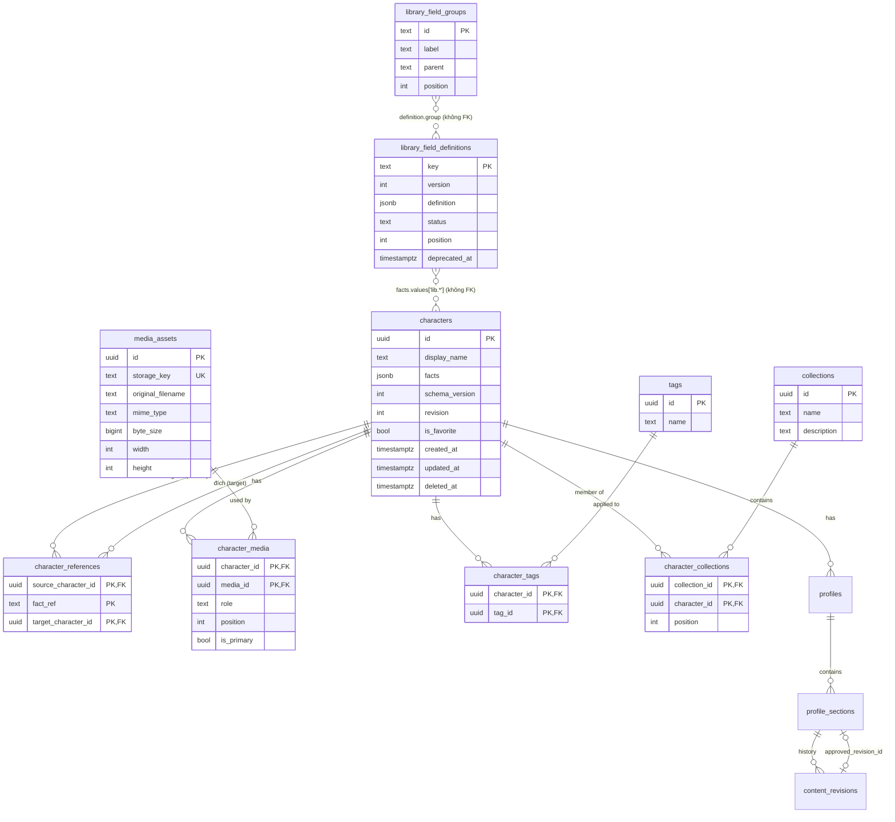

# Database Design

> TASK 03 (hồ sơ: TASK 06). PostgreSQL 17 + Drizzle ORM (`pg` driver). Schema: `src/db/schema/`; migrations:
> `src/db/migrations/` (quy trình: [database-migrations.md](./database-migrations.md)).
> Domain dữ kiện: [character-fact-schema.md](./character-fact-schema.md) (`schemaVersion: 3`).

## 1. Tổng quan

13 bảng, chỉ phục vụ những nhu cầu đã được xác nhận:

| Bảng                                    | Vai trò                                                                                            |
| --------------------------------------- | -------------------------------------------------------------------------------------------------- |
| `characters`                            | Mỗi OC một dòng: tên hiển thị, dữ kiện (JSONB), phiên bản schema, revision, yêu thích, soft delete |
| `character_references`                  | **Index dẫn xuất** của các tham chiếu liên kết trong `characters.facts`                            |
| `library_field_groups`                  | Nhóm tùy chỉnh dùng chung (`lg_*`)                                                                 |
| `library_field_definitions`             | Định nghĩa trường dùng chung (`lib.*`), có `version` và `status`                                   |
| `media_assets`                          | Metadata tệp ảnh (không lưu binary)                                                                |
| `character_media`                       | Ảnh nào thuộc OC nào, vai trò (avatar/tham khảo), thứ tự, ảnh chính                                |
| `tags` / `character_tags`               | Thẻ và liên kết nhiều–nhiều với OC                                                                 |
| `collections` / `character_collections` | Bộ sưu tập phẳng và liên kết nhiều–nhiều với OC                                                    |
| `profiles`                              | Hồ sơ văn bản của OC (TASK 06): một hồ sơ chính mỗi OC, `revision` cho cấu trúc mục                |
| `profile_sections`                      | Mục hồ sơ: tên, thứ tự, ẩn/hiện, nhóm dữ kiện nguồn, bản nháp (Tiptap JSON) và bản đã duyệt        |
| `content_revisions`                     | Lịch sử nội dung bất biến của từng mục (mốc tự động, duyệt, khôi phục, xung đột)                   |

Định nghĩa trường **riêng của nhân vật** (`custom.*`, `cg_*`) không có bảng riêng: chúng nằm trong `characters.facts.custom` đúng theo domain contract, được validate cùng dữ kiện.

## 2. ERD



## 3. Bảng và ràng buộc

Mọi `created_at`/`updated_at` là `timestamptz NOT NULL DEFAULT now()`. ID dạng UUID dùng `gen_random_uuid()` (có sẵn từ PostgreSQL 13, không cần extension).

### `characters`

| Cột                        | Kiểu          | Ràng buộc                                                                               |
| -------------------------- | ------------- | --------------------------------------------------------------------------------------- |
| `id`                       | `uuid`        | PK, mặc định `gen_random_uuid()` (repository có thể truyền id khi import)               |
| `display_name`             | `text`        | NOT NULL; CHECK không rỗng sau `btrim`, ≤ 200 ký tự (`LIMITS.displayName`)              |
| `facts`                    | `jsonb`       | NOT NULL; CHECK là object, có khóa `values`, **không** có `displayName`/`schemaVersion` |
| `schema_version`           | `integer`     | NOT NULL, ≥ 1                                                                           |
| `revision`                 | `integer`     | NOT NULL DEFAULT 1, ≥ 1                                                                 |
| `is_favorite`              | `boolean`     | NOT NULL DEFAULT false                                                                  |
| `created_at`, `updated_at` | `timestamptz` | NOT NULL                                                                                |
| `deleted_at`               | `timestamptz` | NULL = đang hoạt động                                                                   |

Index: `characters_active_updated_at_idx (updated_at DESC) WHERE deleted_at IS NULL` (danh sách thư viện), `characters_active_display_name_idx (display_name) WHERE deleted_at IS NULL`.

### `character_references` (index dẫn xuất)

| Cột                   | Ràng buộc                                                                                                                             |
| --------------------- | ------------------------------------------------------------------------------------------------------------------------------------- |
| `source_character_id` | FK → `characters.id` ON DELETE CASCADE                                                                                                |
| `fact_ref`            | Fact ref chứa tham chiếu: `relationships.entries[rel_1]`, `custom.mentor`… (tham chiếu lồng trong phần tử được ghi ở ref của phần tử) |
| `target_character_id` | FK → `characters.id` ON DELETE RESTRICT                                                                                               |

PK `(source_character_id, fact_ref, target_character_id)`; index `character_references_target_idx (target_character_id)`.

### `library_field_groups`, `library_field_definitions`

| Bảng                        | Cột chính                                                                               | Ràng buộc                                                                                                                                                                                     |
| --------------------------- | --------------------------------------------------------------------------------------- | --------------------------------------------------------------------------------------------------------------------------------------------------------------------------------------------- |
| `library_field_groups`      | `id text` PK, `label`, `parent` (nhóm có sẵn hoặc `lg_*`, không FK), `position`         | CHECK `starts_with(id, 'lg_')`, nhãn không rỗng                                                                                                                                               |
| `library_field_definitions` | `key text` PK, `version int`, `definition jsonb`, `status`, `position`, `deprecated_at` | CHECK `starts_with(key, 'lib.')`; `version ≥ 1`; `definition` là object **không** chứa `key`/`version`; `status ∈ {active, deprecated}`; `deprecated_at` có giá trị ⇔ `status = 'deprecated'` |

`parent`/`group` không phải FK vì có thể trỏ tới nhóm có sẵn (chỉ tồn tại trong code); tính hợp lệ do `libraryDefinitionsSchema` của domain kiểm tra ở mọi đường ghi.

### `media_assets`, `character_media`

| Bảng              | Ràng buộc                                                                                                                                                                                                                                                     |
| ----------------- | ------------------------------------------------------------------------------------------------------------------------------------------------------------------------------------------------------------------------------------------------------------- |
| `media_assets`    | `storage_key` UNIQUE, không rỗng, ≤ 1 024; `original_filename` ≤ 255; `mime_type ~ '^image/…'`; `byte_size > 0`; `width`/`height` cùng NULL hoặc cùng > 0                                                                                                     |
| `character_media` | PK `(character_id, media_id)`; FK `character_id` ON DELETE CASCADE, `media_id` ON DELETE RESTRICT; `role ∈ {avatar, reference}`; `position ≥ 0`; UNIQUE một `avatar` mỗi OC (partial index); UNIQUE một `is_primary` mỗi OC (partial index); index `media_id` |

### `tags`, `character_tags`, `collections`, `character_collections`

| Bảng                    | Ràng buộc                                                                                             |
| ----------------------- | ----------------------------------------------------------------------------------------------------- |
| `tags`                  | `name` đã trim, không rỗng, ≤ 100; UNIQUE `lower(name)`                                               |
| `character_tags`        | PK `(character_id, tag_id)`; cả hai FK ON DELETE CASCADE; index `tag_id`                              |
| `collections`           | `name` đã trim, không rỗng, ≤ 200; UNIQUE `lower(name)`; `description` ≤ 2 000                        |
| `character_collections` | PK `(collection_id, character_id)`; cả hai FK ON DELETE CASCADE; `position ≥ 0`; index `character_id` |

Tên không phải khóa chính: đổi tên thẻ/bộ sưu tập không ảnh hưởng liên kết. Bộ sưu tập phẳng (không lồng nhau).

## 4. JSONB `characters.facts`

`facts` = `CharacterFacts` **trừ** `displayName` và `schemaVersion`:

```json
{
  "sourceLanguage": "vi",
  "values": { "identity.full_name": { "state": "specified", "value": "Trần Bảo Ngọc" } },
  "custom": { "groups": [], "fields": [] }
}
```

- **Một nguồn sự thật:** `display_name` và `schema_version` là cột; CHECK `characters_facts_shape` cấm JSONB mang bản sao. Repository ghép lại khi đọc (`{ ...facts, schemaVersion, displayName }`) và tách ra khi ghi (`toStoredColumns`). Lý do để `schema_version` là cột: cần đọc phiên bản _trước_ khi hiểu JSON (chọn migration), lọc/đếm theo phiên bản bằng SQL, và tránh hai giá trị mâu thuẫn.
- **Mọi đường ghi validate** bằng `parseCharacterFacts(facts, { library })` với toàn bộ định nghĩa dùng chung (cả deprecated). Không strip khóa lạ, không biến đổi giá trị: dữ liệu không hợp lệ bị từ chối (`validation_failed` kèm đường dẫn lỗi).
- **Đọc dữ liệu cũ:** `schema_version` < hiện tại ⇒ `migrateCharacterFacts` trong bộ nhớ; kết quả trả về kèm `pendingMigration { fromVersion, review }`; **không ghi** khi đọc. Lần `update` kế tiếp lưu phiên bản hiện tại. Phiên bản không hỗ trợ ⇒ `unsupported_schema`, dòng giữ nguyên.
- Không có GIN index trên `facts` (chưa có truy vấn bên trong JSON ngoài kiểm tra định nghĩa đang dùng); thêm khi có nhu cầu tìm kiếm.

## 5. Optimistic locking

- `revision` bắt đầu từ 1, tăng 1 ở mỗi thay đổi `display_name`/`facts` (kể cả khi bị viết lại do OC được tham chiếu bị xóa) và khi soft delete.
- `update(id, facts, expectedRevision)`: `UPDATE … SET revision = revision + 1 WHERE id = $1 AND revision = $2 AND deleted_at IS NULL RETURNING …`. Không có dòng ⇒ `revision_conflict { expectedRevision, actualRevision }` hoặc `not_found`. Không bao giờ ghi đè dữ liệu mới hơn.
- `softDelete(id, expectedRevision)` cũng yêu cầu revision hiện tại.
- `is_favorite` là metadata thư viện, **không** tăng revision (đánh dấu yêu thích không làm editor đang mở bị xung đột).
- Định nghĩa dùng chung dùng `version` theo cùng cách (`updateField(key, next, expectedVersion)`).

## 6. Định nghĩa trường dùng chung — phiên bản

- Tạo: `version = 1`. Mỗi lần sửa thành công: `version + 1`.
- Chỉ chấp nhận thay đổi **tương thích** (`findBreakingChanges(prev, next)` rỗng): đổi nhãn/mô tả/nhóm/độ nhạy cảm, thêm lựa chọn/đơn vị/trường con tùy chọn, nới khoảng… ⇒ mọi giá trị đã lưu theo phiên bản trước vẫn hợp lệ, nên **không** cần lưu phiên bản định nghĩa trong từng giá trị.
- Thay đổi phá vỡ ⇒ `definition_breaking_change` (kèm danh sách thay đổi); muốn đổi nghĩa phải tạo **khóa mới**.
- `deprecateField`: `status = 'deprecated'` — vẫn được tải và dùng để validate các OC đã dùng; repository từ chối OC **mới bắt đầu** dùng trường deprecated (`definition_deprecated`).
- `deleteUnusedField`: chỉ xóa định nghĩa `active` chưa từng xuất hiện trong `facts.values` của bất kỳ OC nào (kể cả đã soft delete). Định nghĩa deprecated không bao giờ bị xóa ⇒ khóa không bao giờ được tái sử dụng.
- Khi ghi một OC, repository khóa `FOR SHARE` các định nghĩa `lib.*` nó dùng, nên một thao tác xóa định nghĩa chạy song song phải chờ và sẽ thấy định nghĩa đang được dùng.

## 7. Index tham chiếu nhân vật

- Nguồn sự thật là `characters.facts`; `character_references` chỉ là index để trả lời "ai đang tham chiếu tới B?". Không có API ghi trực tiếp vào bảng này.
- Index của một OC được **xóa và dựng lại** từ `collectLinkedReferences(facts)` trong cùng transaction ghi facts ⇒ rollback thì index cũng rollback.
- Mỗi dòng ghi lại một (nguồn, fact ref, đích); nhiều tham chiếu tới cùng đích ở cùng ref được gộp.
- Khi ghi, mọi đích được khóa `FOR SHARE` và phải tồn tại, chưa bị soft delete; nếu không ⇒ `reference_target_missing { characterIds }` và toàn bộ thao tác rollback.
- **Import với ID chưa có trong thư viện:** repository từ chối (`reference_target_missing` liệt kê các ID). Luồng import (task sau) phải chuyển các tham chiếu đó thành `unlinked` (với tên có trong dữ liệu import) _trước khi_ gọi repository, hoặc import các OC đích trước. Repository không tự đoán.
- Tham chiếu `unlinked` (kể cả `detachedFrom`) không vào index.

## 8. Soft delete và giữ quan hệ

`softDelete(id, expectedRevision, at)` — một transaction:

1. `SELECT … FOR UPDATE` OC đích; kiểm tra tồn tại, chưa xóa, đúng revision.
2. Đọc các OC nguồn từ `character_references` (trừ chính nó).
3. `SELECT … FOR UPDATE` các OC nguồn, **theo thứ tự `id`**.
4. Với mỗi nguồn: đọc facts (migrate trong bộ nhớ nếu cũ) → `detachDeletedCharacter` (tên tại thời điểm xóa, `detachedFrom`, giữ loại/trạng thái/mô tả/ghi chú và metadata nhạy cảm) → validate → ghi facts + phiên bản hiện tại, `revision + 1`, `updated_at` → dựng lại index.
5. Tham chiếu tới chính nó (nếu có) cũng được detach.
6. Đặt `deleted_at`, `revision + 1` cho OC đích.

Bất kỳ bước nào lỗi (ví dụ một OC nguồn có dữ liệu không hợp lệ) ⇒ rollback toàn bộ: đích chưa bị xóa, không nguồn nào bị đổi.

Ngữ nghĩa soft delete:

- `getById`/`list`/`update` mặc định coi OC đã xóa là `not_found`; `includeDeleted` để đọc.
- Dòng, liên kết tag/collection/media và index tham chiếu **đi ra** của OC đã xóa được giữ nguyên (để có thể khôi phục).
- Không có hard delete trong TASK 03. FK `character_references.target_character_id ON DELETE RESTRICT` ngăn hard delete một OC vẫn đang bị tham chiếu.
- **Khôi phục** (chưa triển khai): không tự liên kết lại; `detachedFrom.characterId` đủ để _gợi ý_ liên kết lại thủ công.

## 9. Transaction và khóa

| Thao tác                                 | Transaction | Thứ tự khóa                                                              |
| ---------------------------------------- | ----------- | ------------------------------------------------------------------------ |
| `create`                                 | Có          | định nghĩa `lib.*` dùng (SHARE) → chèn dòng mới → các đích (SHARE)       |
| `update`                                 | Có          | định nghĩa `lib.*` dùng (SHARE) → các đích (SHARE) → dòng nguồn (UPDATE) |
| `softDelete`                             | Có          | đích (UPDATE) → các nguồn (UPDATE, theo `id`)                            |
| `updateField` / `deleteUnusedField`      | Có          | dòng định nghĩa (UPDATE)                                                 |
| `setPrimary` (media)                     | Có          | liên kết ảnh (UPDATE)                                                    |
| Cấu trúc hồ sơ (thêm/đổi tên/sắp xếp/ẩn) | Có          | dòng `profiles` (UPDATE; OC phải chưa bị xóa)                            |
| Nội dung mục (lưu nháp/duyệt/khôi phục)  | Có          | dòng `profile_sections` (UPDATE)                                         |
| Thao tác một câu lệnh (tag, favourite…)  | Ngầm định   | —                                                                        |

Lý do thứ tự: `update` khóa đích **trước** khi khóa dòng của chính nó, nên không thể tạo vòng chờ với `softDelete` (khóa đích rồi mới khóa nguồn). Hệ quả: một `update` thêm tham chiếu tới B và một `softDelete(B)` chạy song song luôn kết thúc ở một trong hai trạng thái hợp lệ — update thắng (rồi bị detach bởi delete) hoặc delete thắng (update nhận `reference_target_missing`). Có integration test cho race này.

Trường hợp còn lại có thể deadlock: xóa đồng thời hai OC tham chiếu lẫn nhau. PostgreSQL phát hiện và hủy một transaction; repository trả `concurrent_modification` (người dùng thử lại).

Mức cô lập: READ COMMITTED mặc định; tính đúng dựa trên khóa dòng ở trên, không dựa trên SERIALIZABLE.

## 10. Ảnh — quyền sở hữu

- `media_assets` thuộc thư viện; `character_media` gắn ảnh vào OC. Một ảnh có thể dùng cho nhiều OC.
- `storage_key` là khóa trung lập với nơi lưu (ví dụ `media/2026/10/<uuid>.webp`); adapter lưu trữ (task sau) ánh xạ sang đường dẫn đĩa hoặc URL object storage. Chuyển nơi lưu chỉ đổi cấu hình/adapter, không đổi dòng và không đổi character facts (facts không chứa đường dẫn ảnh).
- Xóa OC (hard delete, tương lai) xóa liên kết; ảnh còn lại để dọn dẹp riêng. `media_id ON DELETE RESTRICT` ngăn xóa ảnh đang được dùng.
- "Ảnh chính" (`is_primary`) độc lập với vai trò: có thể là avatar hoặc ảnh tham khảo; tối đa một mỗi OC. (TASK 04 dùng avatar làm ảnh của nhân vật; chưa có UI chọn ảnh chính.)

### Lưu trữ và phục vụ ảnh (TASK 04)

- `MediaStorage` (`src/features/media/server/storage.ts`): `put` / `get` / `delete` theo storage key. Bản hiện tại là `LocalFileStorage` tại `MEDIA_STORAGE_DIR` (mặc định `<dự án>/storage`, ngoài `public/`). Key do server sinh (`media/YYYY/MM/<uuid>.<ext>`), được kiểm tra bằng regex và đường dẫn phân giải phải nằm trong thư mục gốc ⇒ không có path traversal. Ghi qua file tạm rồi đổi tên (không để lại file dở dang).
- Upload (`uploadCharacterImage`): kiểm tra kích thước (≤ 8 MB; body Server Action giới hạn 9 MB) → nhận diện **chữ ký tệp** (PNG/JPEG/GIF/WebP; SVG bị từ chối) và kích thước ảnh từ header → ghi file → `createAndAttach` (một transaction: tạo `media_assets`, gắn `character_media`, thay avatar cũ). Nếu bước database lỗi, file vừa ghi bị xóa. Avatar bị thay và ảnh bị gỡ được xóa (dòng + file) khi không còn nhân vật nào dùng (`deleteIfUnused`).
- Phục vụ: `GET /media/[id]` tra `media_assets` theo UUID, đọc qua storage, trả `Content-Type` đã nhận diện, `X-Content-Type-Options: nosniff`, `Content-Security-Policy: default-src 'none'; sandbox`, cache dài hạn (một id không bao giờ đổi nội dung). Client không bao giờ gửi đường dẫn.
- Còn tồn tại: nếu xóa file của ảnh bị thay thất bại sau khi transaction đã commit, file mồ côi chỉ được ghi log (chưa có tác vụ dọn dẹp định kỳ).

## 11. Lỗi có cấu trúc

Repositories chỉ ném `RepositoryError` (`src/db/repository-errors.ts`) với `code`:

`validation_failed` · `not_found` · `revision_conflict` · `reference_target_missing` · `definition_breaking_change` · `definition_in_use` · `definition_deprecated` · `duplicate` · `unsupported_schema` · `concurrent_modification` · `database_error`.

Lỗi driver được chuyển đổi (23505 → `duplicate`, 40P01/40001 → `concurrent_modification`, còn lại → `database_error`); thông điệp gốc chỉ giữ ở `cause` cho log phía server.

## 12. Repositories (TASK 03)

| Repository                                                 | Phương thức                                                                                                                                                                                                            |
| ---------------------------------------------------------- | ---------------------------------------------------------------------------------------------------------------------------------------------------------------------------------------------------------------------- |
| `createCharacterRepository(db)`                            | `create`, `getById`, `list`, `update`, `setFavorite`, `softDelete`                                                                                                                                                     |
| `createLibraryDefinitionRepository(db)`                    | `load`, `listFields`, `createGroup`, `createField`, `updateField`, `deprecateField`, `deleteUnusedField`                                                                                                               |
| `createTagRepository(db)`                                  | `create`, `list`, `get`, `findByName` (không phân biệt hoa thường), `attach`, `detach`, `listForCharacter`                                                                                                             |
| `createCollectionRepository(db)`                           | `create`, `list`, `get`, `listWithCounts`, `count`, `update` (đổi tên/mô tả), `delete` (chỉ xóa bộ sưu tập và liên kết — nhân vật giữ nguyên), `listForCharacter`, `addCharacter`, `removeCharacter`, `listCharacters` |
| `createMediaRepository(db)`                                | `createAsset`, `getAsset`, `createAndAttach`, `deleteIfUnused`, `attach`, `setPrimary`, `detach`, `listForCharacter`                                                                                                   |
| `listLibraryCharacters(db, filter)`, `getLibraryStats(db)` | Truy vấn chỉ đọc cho thư viện: tìm theo tên (ILIKE, escape ký tự đại diện), sắp xếp theo tên/ngày tạo/ngày cập nhật, lọc yêu thích/thẻ/bộ sưu tập; kèm avatar, thẻ và tóm tắt                                          |
| `createProfileRepository(db)` (TASK 06)                    | `getPrimary`, `createPrimary`, `getPrimarySummary`, `addSection`, `updateSection`, `reorderSections`, `getSection`, `getSectionContext`, `saveDraft`, `approve`, `listHistory`, `getRevision`, `restore`               |

Hàm factory nhận `db` (production: `getDb()`; test: database test). Tất cả `import "server-only"`. Từ TASK 04, giao diện gọi chúng qua Server Actions (`src/features/*/actions.ts`); không có REST API.

## 13. Hồ sơ nhân vật (TASK 06)

Hồ sơ là **văn bản** viết từ dữ kiện; dữ kiện vẫn chỉ nằm trong `characters.facts`. Hồ sơ không chép giá trị dữ kiện: mỗi mục chỉ ghi tên các nhóm dữ kiện nguồn (`source_groups`), và khi duyệt chỉ lưu **fingerprint** (`FactSnapshot`) của các dữ kiện đó.

| Bảng                | Cột chính / ràng buộc                                                                                                                                                                                                                                                                                                                                                                                                                     |
| ------------------- | ----------------------------------------------------------------------------------------------------------------------------------------------------------------------------------------------------------------------------------------------------------------------------------------------------------------------------------------------------------------------------------------------------------------------------------------- |
| `profiles`          | `character_id` FK → `characters` ON DELETE CASCADE; `is_primary`; UNIQUE một hồ sơ chính mỗi OC (partial index); `revision ≥ 1` khóa lạc quan cho **cấu trúc** (thêm, đổi tên, sắp xếp, ẩn/hiện, nhóm nguồn)                                                                                                                                                                                                                              |
| `profile_sections`  | `key` cố định (khóa mục có sẵn như `appearance`, hoặc `ps_<ngẫu nhiên>`), UNIQUE `(profile_id, key)`; `title` NULL = tên mặc định (đã trim, ≤ 120); `position ≥ 0`; `is_hidden`; `source_groups text[]` (≤ 40); `draft_content jsonb` (NULL hoặc `{"type":"doc"…}`); `draft_revision ≥ 1`; `approved_revision_id` FK tổ hợp `(approved_revision_id, id)` → `content_revisions(id, section_id)` nên bản duyệt chắc chắn thuộc chính mục đó |
| `content_revisions` | Bất biến. `kind ∈ {autosave, approval, before_restore, restore, conflict}`; `content` (Tiptap JSON), `content_hash`; `restored_from_id`; `fact_snapshot` (chỉ fingerprint, khi duyệt); index `(section_id, created_at DESC)`                                                                                                                                                                                                              |

- **Nội dung:** Tiptap JSON giới hạn (đoạn, tiêu đề cấp 2–3, đậm/nghiêng/gạch chân, danh sách, trích dẫn, xuống dòng) — `richTextDocumentSchema` (`src/features/profiles/domain/content.ts`) từ chối mọi node/mark/thuộc tính khác; ≤ 100 000 ký tự, lồng ≤ 12 cấp. Repository validate ở mọi đường ghi và cả khi đọc.
- **Bản nháp và bản đã duyệt:** sửa chỉ ghi `draft_content` (`saveDraft(…, expectedDraftRevision)` → `revision_conflict` nếu cũ). Duyệt (`approve(sectionId, expectedDraftRevision, snapshot)`) chép bản nháp **đã lưu** thành một dòng `approval` và trỏ `approved_revision_id` vào đó; nội dung trùng bản đã duyệt ⇒ không ghi gì. Không đường ghi nào sửa bản đã duyệt từ bản nháp.
- **Lịch sử theo mốc, không theo phím:** `autosave` = bản nháp đã lưu trước đó, ghi khi lần lưu mới đến sau ≥ 15 phút ngừng sửa (hoặc mục lịch sử gần nhất đã cũ ≥ 15 phút); `before_restore` + `restore` khi khôi phục; `conflict` = bản mới hơn từ tab khác bị thay khi người dùng chọn "Giữ bản của tôi". Không ghi nếu nội dung trùng mục lịch sử gần nhất hoặc bản nháp trống. Khôi phục không đổi bản đã duyệt.
- **Mỗi mục khóa riêng** (`draft_revision`), nên sửa hai mục ở hai tab không xung đột; cấu trúc dùng `profiles.revision`.
- **Phát hiện lỗi thời:** trang hồ sơ so `fact_snapshot` của bản đã duyệt với fingerprint hiện tại (`assessFactSnapshot`) và báo các dữ kiện nguồn đã đổi. TASK 07 dùng cùng cơ chế cho ứng viên AI.
- **Tạo hồ sơ** là thao tác rõ ràng (nút "Tạo hồ sơ"); mở trang không ghi gì. `createPrimary` an toàn khi bấm đồng thời (ON CONFLICT trên index hồ sơ chính).
- **Khóa:** cấu trúc — dòng `profiles` (UPDATE); nội dung — dòng `profile_sections` (UPDATE); cả hai đều chỉ trên OC chưa bị xóa.

### Điểm mở rộng cho TASK 07 (chưa triển khai)

Ứng viên AI dự kiến là một `kind` mới của `content_revisions` (hoặc bảng `ai_generations` riêng) mang `fact_snapshot` + phạm vi dữ kiện đã gửi (`selectFactsForAi`); duyệt ứng viên = ghi nó thành bản nháp/bản duyệt qua cùng các đường `saveDraft`/`approve`, nên nội dung sửa tay vẫn nằm trong lịch sử. TASK 06 không gọi AI và không tạo bảng/cột giữ chỗ cho AI.

## 14. Bảng được trì hoãn

Không tạo bảng, cột hay JSON giữ chỗ cho các phần chưa được đặc tả:

| Dự kiến             | Quan hệ dự kiến (chỉ ghi nhận)                                                                   |
| ------------------- | ------------------------------------------------------------------------------------------------ |
| `ai_generations`    | Lần gọi AI: OC, phạm vi dữ kiện, quyền nhạy cảm đã cấp _cho lần đó_, snapshot fingerprint        |
| `profile_templates` | Mẫu hồ sơ do người dùng lưu (TASK 06 chỉ có mẫu mặc định trong code: `DEFAULT_PROFILE_TEMPLATE`) |
| `pdf_templates`     | Mẫu xuất PDF                                                                                     |

## 15. Quyết định và đánh đổi

| Quyết định                                                    | Ưu                                                                                            | Nhược                                                       |
| ------------------------------------------------------------- | --------------------------------------------------------------------------------------------- | ----------------------------------------------------------- |
| Facts trong một cột JSONB thay vì bảng EAV/từng trường        | Khớp domain, một lần validate, migration JSON độc lập với DDL, trường tùy chỉnh không cần DDL | Truy vấn SQL vào bên trong dữ kiện phức tạp hơn             |
| `display_name`/`schema_version` là cột, cấm trùng trong JSONB | Một nguồn sự thật, sắp xếp/lọc nhanh                                                          | Repository phải ghép/tách                                   |
| Index tham chiếu dẫn xuất + FK                                | Tìm "ai tham chiếu B" nhanh; FK chặn tham chiếu tới ID không tồn tại                          | Phải dựng lại trong mọi đường ghi (đã gói trong repository) |
| Chỉ cho phép sửa định nghĩa tương thích                       | Dữ liệu cũ luôn hợp lệ, không cần lưu phiên bản theo giá trị                                  | Đổi nghĩa phải tạo khóa mới                                 |
| Soft delete, không hard delete                                | Khôi phục được, quan hệ không mất                                                             | Dữ liệu đã xóa vẫn chiếm chỗ; cần chính sách dọn dẹp sau    |
| Revision số nguyên thay vì timestamp                          | Không phụ thuộc đồng hồ/độ phân giải thời gian                                                | —                                                           |
| Migrate JSON khi đọc, ghi khi cập nhật                        | Không chạy migration hàng loạt rủi ro; dữ liệu gốc giữ nguyên tới khi người dùng lưu          | Dữ liệu cũ tồn tại lâu; mỗi lần đọc tốn chi phí migrate     |
